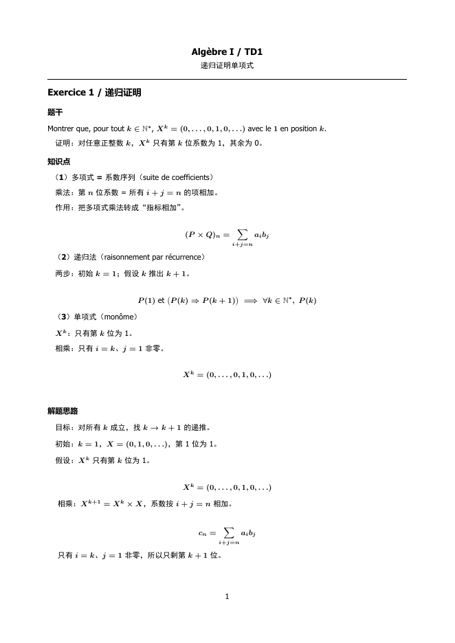

# TD Radar

**把 Canvas 上的 TD PDF 转成结构化的法/中双语详解 PDF。**

TD Radar 会轮询 Canvas 课程，下载新发布的 TD（travaux dirigés）文件，抽取文本并检查文本层质量，再让 LLM 生成结构化解答，最后用 LaTeX 渲染成紧凑的 PDF。

> 个人项目，面向 SPEIT / 上海交大 Canvas 的使用场景。与 SJTU、Canvas、DeepSeek 均无隶属关系。
> `docs/` 里的样张是合成的，不是课程材料。

[English](README.md) | **简体中文**



## 功能

- **Canvas 轮询**：列出、轮询、下载 TD 文件，本地 state 去重。
- **文本质量门**：在送给 LLM 前识别坏掉的 PDF 文本层。
- **结构化 LLM 输出**：法语解答、中文翻译、行内条件、居中的关键公式。
- **LaTeX PDF**：A4、Tahoma + SimHei、加粗公式、受控分页。
- **可复用管线**：`PDF -> 抽取 -> 质量门 -> LLM -> JSON -> PDF`。
- **Console CLI**：`tdradar doctor`、`tdradar canvas`、`tdradar generate`。
- **可打包 console 程序**：PyInstaller onedir exe。

## 演示

- 合成样张：[`docs/sample.pdf`](docs/sample.pdf)
- 预览图：[`docs/sample.png`](docs/sample.png)

## 环境要求

- Windows 10/11
- Python 3.12（开发）
- LaTeX 引擎：目前是 **MiKTeX `xelatex`**；Tectonic 内置还在计划中
- Canvas personal access token
- OpenAI 兼容的 DeepSeek 接口 + key

## 配置

```powershell
git clone https://github.com/PlasmaPerfuma/speit-td-radar.git
cd speit-td-radar

python -m venv .venv
.\.venv\Scripts\Activate.ps1
pip install -r requirements.txt

copy data\llm_config.example.json data\llm_config.json
copy data\canvas_token.example.txt data\canvas_token.txt
```

编辑 `data\llm_config.json`：

```json
{
  "base_url": "https://api.deepseek.com",
  "api_key": "sk-...",
  "model": "deepseek-flash",
  "max_tokens": 100000,
  "timeout": 180,
  "reasoning_effort": null
}
```

Canvas token 放在 `data\canvas_token.txt`，一行，不要加引号。

不要把 `data\llm_config.json`、`data\canvas_token.txt` 提交到 Git；两者都在 `.gitignore` 里。

## 使用

```powershell
# 检查 token / LLM 配置 / LaTeX / state
python app\tdradar.py doctor

# 列出配置课程里的 TD 文件
python app\tdradar.py canvas list

# 第一次运行：把现有文件标记为 baseline，不批量下载
python app\tdradar.py canvas poll --once --bootstrap

# 之后：只下载新文件或更新过的文件
python app\tdradar.py canvas poll --once --download

# 自动下载 + 为新 sujet 生成详解 PDF
python app\tdradar.py canvas poll --once --download --process

# 持续轮询（5 分钟一次）
python app\tdradar.py canvas poll --interval 300 --download

# 按文件名下载单个文件
python app\tdradar.py canvas download --course 95175 --match TD7_e

# 手动跑完整管线：已下载 PDF -> 详解 PDF
python app\tdradar.py generate --pdf inbox\canvas\algebre\TD7\Algèbre_TD7_e.pdf `
  --course "Algèbre I" --td TD7
```

输出在 `out\<course>_<td>\`：

- `llm_raw.json`
- `td_detail.json`
- `td_detail.pdf`
- `meta.json`

## 架构

```text
Canvas API ──► app/canvas.py ──► data/canvas_state.json
                    │
                    ▼
              inbox/canvas/...
                    │
app/pipeline.py ──► extract.py ──► quality.py ──► analyze.py ──► td_render.py
                                                          │
                                                          ▼
                                                    out/.../td_detail.pdf
```

| 路径 | 作用 |
|---|---|
| `app/tdradar.py` | Console 入口：`doctor` / `canvas` / `generate` |
| `app/canvas.py` | Canvas 发现、轮询、state、签名 URL 下载 |
| `app/pipeline.py` | 可复用 PDF -> 质量门 -> LLM -> PDF |
| `app/extract.py` | `pdftotext` 封装 |
| `app/quality.py` | 坏文本层指标与质量门 |
| `app/analyze.py` | LLM prompt、JSON schema、normalize |
| `app/llm.py` | OpenAI 兼容客户端 + 本地配置 |
| `app/td_render.py` | LaTeX 渲染与编译封装 |
| `app/paths.py` | 开发期用 repo 路径；打包后用 `%APPDATA%\TD Radar` |
| `packaging/` | PyInstaller 构建脚本与说明 |

## 测试

```powershell
python -m unittest discover -s tests -p "test_*.py" -v
```

测试都是离线的，不需要 Canvas token 或 API key。

## 隐私与安全

- Canvas token、API key 只存在本地 `data/`，已被 Git 忽略。
- 课程 PDF、corrigé、日志、生成 PDF 都已被 Git 忽略。
- 不要发布课程材料；本仓库只授权源代码。
- 如果 token/key 曾经提交过，立刻 rotate。
- 使用前请自行确认 Canvas/DeepSeek 的服务条款。
- 日志和生成文件都留在本地。

## 当前限制

- Windows 优先；路径和 `xelatex` 是 Windows 风格。
- Canvas 课程 ID 目前硬编码为 SJTU 的（`app/canvas.py`）。
- 打包后的 exe 仍调用系统 MiKTeX；Tectonic 还没内置。
- `--process` 已把下载和新 sujet 的生成接起来；corrigé 自动处理尚未开启。
- 还没有计划任务、托盘、安装包、手机推送、OCR/VLM 回退。
- 整份 TD 的端到端生成还没充分验证；样张主要验证单题。

## Roadmap

- [x] 把 `canvas poll --download` 接进 `pipeline.process_pdf`
- [ ] 内置 Tectonic / 便携 LaTeX
- [ ] Inno Setup per-user 安装包，不弹 UAC
- [ ] Windows 计划任务 / 托盘 / 通知
- [ ] 泛化 Canvas base URL 与课程配置
- [ ] 坏文本层的 OCR/VLM 回退
- [ ] 可选的手机推送 / AI 对话 / 工作流接口

## License

源代码 MIT。课程 PDF、corrigé 和其他教学材料**不属于**本项目，也不得随仓库分发。
